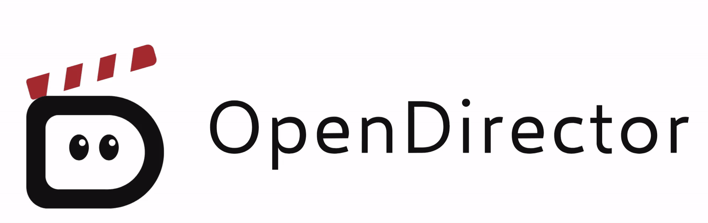
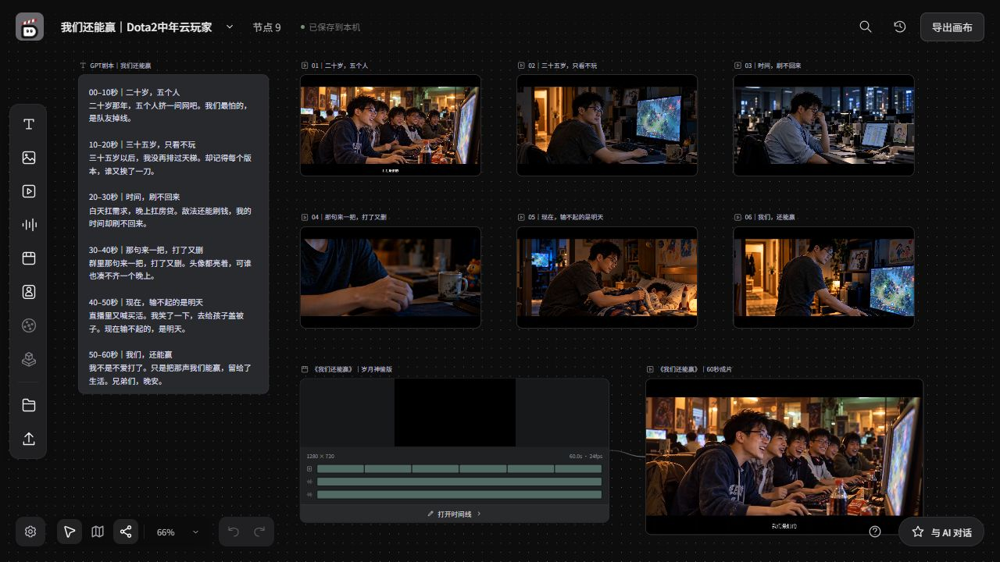

<p align="center">
  <picture>
    <source media="(prefers-reduced-motion: reduce) and (prefers-color-scheme: dark)" srcset="src/assets/opendirector-header-dark.png" />
    <source media="(prefers-reduced-motion: reduce)" srcset="src/assets/opendirector-header-light.png" />
    <source media="(prefers-color-scheme: dark)" srcset="src/assets/opendirector-header-dark.gif" />
    
  </picture>
</p>

<p align="center">
  <a href="README.md">English</a> | <strong>简体中文</strong>
</p>

# OpenDirector

**从创作想法到可下载的短片：对话生成、画布管理、媒体编辑、时间线导出。**

OpenDirector 是一个在本地运行、通过浏览器使用的 AI 视频创作工作台。你可以与助手讨论创意并生成素材，在画布上整理和迭代内容，用编辑工具调整图片、视频和音频，再通过时间线编排并导出 MP4。

适合验证视觉创意、反复调整素材和制作短片。项目保存在本机，生成内容使用你选择的服务商 API 或自部署模型服务。

[短片示例](#短片示例我们还能赢) · [快速开始](#快速开始) · [接入模型](#接入模型) · [制作第一支短片](#制作第一支短片) · [故障排查](#故障排查) · [更多文档](#更多文档)

## 能做什么

- **与 AI 协作**：描述创作要求，引用画布素材，让助手保存文本并调用已配置的模型生成内容。
- **画布与参考素材**：上传文件、连接节点或用 `@` 添加参考，集中整理素材并查看生成历史。
- **媒体编辑**：裁剪、调色、处理图层和片段；扩图、消除、抠图等 AI 工具按已接入模型的能力提供。
- **时间线编排**：安排素材顺序、起止点、速度和音量，预览并合成 MP4，也可导出 JSON、FCPXML 和素材包。
- **本地项目，自选模型**：画布自动保存到本机，同一服务可配置多个模型，按用途切换。

## 短片示例：《我们还能赢》

《我们还能赢》是一支关于 Dota2 中年云玩家的 60 秒短片。

下图为在 OpenDirector 中重新打开的真实工程，包含剧本、六个视频镜头、可编辑时间线和合成成片。制作顺序为：剧本与分镜 → 参考图片 → 视频生成 → 配音与配乐 → 时间线剪辑 → 导出 MP4。其中，视频生成使用通过 [vLLM-Omni](https://github.com/vllm-project/vllm-omni) 部署的 FastH3。

[](docs/guides/assets/dota2-short-film-canvas.jpg)

*OpenDirector 实际画布截图，点击图片可查看完整分辨率。*

**验收成片**

https://github.com/user-attachments/assets/11babc03-e35c-40e7-b5f6-7d476b6bf11a

[下载原始成片（MP4，15.7 MiB）](docs/guides/assets/dota2-short-film.mp4?raw=true) · 60 秒 · 1280 × 720 · 24 fps · 配乐：《岁月神偷》。

## 快速开始

### 1. 准备环境

| 依赖 | 要求 |
| --- | --- |
| Git | 用于克隆源码；也可下载仓库 ZIP 并解压 |
| Node.js 与 npm（仅源码构建） | Node.js `24.22.1` 或更新版本，附带 npm；wheel 安装无需此项 |
| Python | `3.11` 或更新版本 |
| FFmpeg | 用于媒体处理；终端中需可运行包含 `libx264` 编码器的 `ffmpeg` 和 `ffprobe` |
| 模型服务（AI 功能需要） | 准备可用的服务地址、Model ID，以及服务要求的 API Key 或其他鉴权信息 |

安装依赖和调用远程模型需要网络。自部署模型服务需另外准备，启动本应用不会自动安装或部署模型。

尚未接入模型也可以安装、打开应用、上传本地素材和编辑工程。AI 对话和生成需要配置模型服务；使用远程服务时，运行本应用的 Mac 无需本地 GPU 推理环境。

#### macOS 环境准备

打开“终端”。没有 Homebrew 时，先按[官方安装说明](https://docs.brew.sh/Installation)安装，并执行安装结束显示的 **Next steps**，将 `brew` 加入 PATH。如果 `git --version` 提示安装 Apple 命令行工具，请先完成安装。

安装运行时和媒体工具：

```sh
brew install node@24 python@3.12 ffmpeg
export PATH="$(brew --prefix node@24)/bin:$PATH"
node --version
npm --version
python3.12 --version
ffmpeg -version
ffprobe -version
ffmpeg -hide_banner -encoders 2>/dev/null | grep libx264
```

确认 Node.js 不低于 `24.22.1`、Python 为 `3.12.x`，最后一条命令列出 `libx264`。Homebrew 的 [Node.js 24](https://formulae.brew.sh/formula/node@24) 需要上面的 PATH 设置；新开终端后，构建前端或使用依赖 Node.js 的助手引擎前应再次执行。下文明确使用 `python3.12`，因为 Mac 默认的 `python3` 可能仍是 Apple 提供的旧版本。已经通过其他方式安装合适运行时的用户，可直接使用现有版本并核对版本号。

合成 MP4 需要浏览器提供 H.264 的 WebCodecs 编码器。Chrome 与 Edge 具备该能力，
Firefox 不具备：Firefox 可用于画布、生成与编辑，但最终导出需在 Chrome 或 Edge 中完成。

先确认媒体工具可用：

```sh
ffmpeg -version
ffprobe -version
```

### 2. 安装并启动

在已启用的 Python 3.11+ 虚拟环境中，源码安装只需：

```sh
git clone https://github.com/ThinkFlowLab/OpenDirector.git
cd OpenDirector
pip install -e .
opendirector serve
```

安装过程会明确执行 `npm ci`、前端构建和内置 OpenCode 校验，无需手动重复这些步骤。源码构建需要 Node.js 24.22.1+、npm 和网络；使用 `pip install -v -e .` 查看完整构建日志。`serve` 仅启动服务，不在启动时下载依赖或构建。

如果尚未创建虚拟环境，先执行一次（macOS 使用已安装的 `python3.12`，Linux 可用 Python 3.11+ 的 `python3`）：

```sh
python3.12 -m venv .venv
source .venv/bin/activate
```

Windows PowerShell：

```powershell
py -3 -m venv .venv
.\.venv\Scripts\Activate.ps1
```

同一个 Python 包支持 wheel 安装，wheel 已包含前端、技能和当前平台的内置 OpenCode，无需 Node.js。发布后可使用 `pip install opendirector`；发布前从项目可信发布渠道取得匹配系统及架构的 wheel，再用 `pip install <wheel路径>` 安装。此说明不表示该版本已上传 PyPI。

### 3. 打开与更新

打开 <http://127.0.0.1:8000>；按 `Ctrl+C` 停止，再次运行 `opendirector serve` 启动。更换端口使用 `opendirector serve --port 8001`，排查问题使用 `--log-level debug`。

源码安装默认将 `projects/` 和 `.opendirector/` 保存在源码目录；wheel 安装默认使用用户主目录下的 `.opendirector/`。可通过 `OPENDIRECTOR_ROOT` 指定数据目录；安装目录只用于读取应用资源。

更新源码后重新运行 `pip install -e .`，再启动服务。修改 Python 源码即时生效；修改前端时使用 `opendirector dev`，或重新安装以构建供 `serve` 使用的产物。开发检查见[验证指南](docs/development/validation.md)。

## 接入模型

点击左下角齿轮进入“设置”，打开“模型接入”，按用途添加对话、图片、视频或音频模型。

1. 选择接入方式和接口协议。
2. 填写服务地址、Model ID，以及服务要求的密钥或鉴权方式。
3. 对视频模型检查适配方式、支持的模式、分辨率和时长。
4. 保存模型，然后在生成面板或对话框中选择它。

配置时可按下面的说明核对字段：

| 字段 | 如何填写 |
| --- | --- |
| 接入方式 | 按实际服务选择“服务商 API”或“自部署服务” |
| 接口协议 | 选择与服务实际接口及模型类别匹配的协议；仅名称相同不代表媒体能力兼容 |
| 服务地址（Base URL） | 填写运行应用的机器能够访问的地址；通过 SSH 隧道连接时使用本地转发地址 |
| API Key | 填写服务要求的密钥；服务确实不要求鉴权时，可勾选“无需密钥”，无需填写占位值 |
| Model ID | 使用服务实际公开的模型名称，通过“获取模型”选择或手动添加 |

同一类别下，一个服务可启用多个模型：填写地址和鉴权后，点击“获取模型”，搜索并勾选需要的模型后保存。未列出的模型可通过“手动添加”补充；对话模型可在列表中逐个测试。服务地址和密钥只保存一份，编辑服务时可统一更新；取消勾选会移除对应模型配置，已选用该配置的位置需要重新选择。

服务地址和 Model ID 应与自己的模型服务一致。自部署服务的地址通常包含 `/v1`，Model ID 使用服务实际公开的模型名称；第三方服务按其提供的信息填写。

自部署的对话服务需要至少 8192 token 的上下文：应用固定发送 `max_tokens: 8192`，
若服务端的 `--max-model-len` 更小（例如 vLLM 的 4096 默认值），每次请求都会返回
HTTP 400。

视频模型的详细配置见 [视频模型能力配置](docs/guides/video-model-capabilities.md)。未提供明确输出规格时，使用“自动”或“服务默认时长”。

自动识别图片选区或视频抠像需要具备分割能力的模型；生成图片、编辑图片仍需选择对应的生成或编辑模型。

生成音乐时，添加音频模型并选择 **vLLM-Omni 音乐生成** 协议，例如用 `vllm serve <model> --omni` 部署的 `m-a-p/YuE2-3B` 或 `MiniMaxAI/MiniMax-Music3`。使用该模型的音频节点以提示词作为风格描述，可填写歌词（留空则生成纯音乐），并设置 8–360 秒的最长时长，模型可能在此之前自然结束。语音合成模型仍然朗读提示词。

参照音乐生成时，把音频节点连到使用 YuE2 的音乐节点，并另外添加一个选择 **vLLM-Omni 扒谱接口** 协议的音频模型：用 vLLM-Omni 的 `tools/sheetsage2_serve.py` 部署的 SheetSage2（见其 SheetSage2 recipe）。参照音乐会先被扒成乐谱，再由 YuE2 按新的风格演绎这份乐谱，可选择只跟随旋律（默认）或跟随旋律与和弦。歌词与不带参照时相同：按参照的乐句填写，或留空生成纯音乐。参照保留的是曲调，不是原唱的声音和音色。不连接参照音乐时，仍只根据文字生成。

使用视频的 **深度动作捕捉** 时，添加视频模型并选择 **vLLM-Omni 深度接口** 协议，例如用 `vllm serve <model> --omni` 部署的 `depth-anything/Video-Depth-Anything-Small`。该工具把不超过 30 秒的视频逐帧转换为 480P 或 720P 的灰度深度视频，近处亮、远处暗，可作为动作和结构参考。深度模型不参与视频生成。

在设置的“通用”页中可切换主题、调整去除水印选项。水印设置仅影响后续生成的内容，实际效果取决于模型服务是否支持。

## 制作第一支短片

建议先完成一个镜头的生成与导出，再扩展到多段素材。

1. **接入模型**：在“设置 → 模型接入”配置需要的图片、视频模型；需要旁白时再配置音频模型。
2. **准备画面**：创建图片节点并生成一张图，或上传已有图片。例如先生成“雨后清晨的街道，柔和晨光，地面有倒影”。
3. **生成视频**：创建视频节点，选择视频模型，将有内容的图片节点连接为参考，按模型支持的模式填写运动描述并生成。在“生成历史”查看进度和结果。
4. **调整素材**：检查画面，按需编辑图片或视频；需要旁白时创建音频节点，填写朗读正文并选择服务支持的音色。
5. **编排时间线**：创建时间线节点并打开编辑器，添加准备好的画面和音频，调整顺序、起止点、速度和音量，再预览检查。
6. **下载短片**：点击“合成 MP4”，保持页面打开直到完成，然后下载结果或将其加入画布。

也可以先通过[与 AI 对话](#与-ai-对话)整理创意、保存文本或生成素材，再继续在画布和时间线中编辑。遇到失败时先查看[生成任务状态](#查看和处理生成任务)，核对原因后再决定是否重新提交。

## 创建和管理画布

首次打开时会创建“未命名画布”，之后打开应用可恢复最近使用的项目。

- 点击左上角项目名称修改名称，按 `Enter` 或点击其他位置保存，按 `Esc` 取消。
- 点击名称右侧的箭头切换项目，选择“新建画布项目”创建项目。
- 在空白画布点击“配置模型”，可直接打开“设置 → 模型接入”。
- 通过左侧工具栏或双击空白画布创建文本、图片、视频、音频、时间线或主体节点。
- 右键空白画布可新建节点、粘贴、撤销或重做。
- 点击左侧“上传”或将文件拖入画布添加素材；“资产库”可选择已有素材。
- 双击节点名称重命名；双击节点内容进入相应编辑或预览界面。

画布会自动保存。关闭或切换前，请确认左上角显示“已保存到本机”；若显示保存失败，保留页面并按提示处理。

## 生成内容与添加参考

1. 创建文本、图片、视频或音频节点，点击节点打开生成面板。
2. 选择模型，填写提示词，并设置可用的参数。
3. 将有内容的来源节点连接到目标节点，或在输入框中输入 `@` 选择参考素材。
4. 检查参考和参数，点击生成。完成后在节点或“生成历史”中查看结果。

输入 `@` 后可用上下方向键选择素材、左右方向键切换分类，按 `Enter` 插入，按 `Esc` 关闭选择。引用以整体形式插入正文；删除同一来源的最后一次引用会移除相应参考连线。

空白节点需要先上传、保存文本或生成内容，才能作为其他节点的有效参考。向已有节点上传本体素材时，文件类型应与节点一致；添加参考请使用连线、`@` 或生成面板的添加入口。

视频生成时按模型能力选择模式：

- **全能参考**：添加模型支持的图片、视频、音频或文字参考。
- **首尾帧**：最多连接两个图片来源，按槽位选择首帧和尾帧；能否使用尾帧以模型能力和界面提示为准。
- **接续**：选择支持该功能的模型和来源视频。服务重启或来源不再可用时，可能需要重新生成来源视频。

音频生成时，在提示词中填写需要朗读的正文，在参数中选择服务支持的音色。

## 查看和处理生成任务

打开右上角“生成历史”，查看任务进度、结果和失败原因。

- 排队或执行中的任务可请求取消。
- 可恢复的中断任务可选择“继续查询原任务”。
- 提交状态不明时，先核对服务端是否已接受任务，再决定是否重新生成，避免重复提交。
- 切换服务地址、模型或协议后，旧任务可能无法继续查询。

## 与 AI 对话

点击右下角“与 AI 对话”，选择对话模型后输入创作要求。可上传、拖放、粘贴素材，或输入 `@` 引用画布中的内容。助手可按要求保存文本，并调用已配置的生成模型制作素材。

点击对话框顶部“新建”开始独立会话；点击“历史会话”可搜索并切换当前画布的旧会话。切换前会保存草稿，切回后恢复消息、参考附件和模型选择，刷新页面仍保留当前会话。回复或参考上传进行中，请先等待完成或停止回复后再切换。

- `Enter` 发送，`Shift+Enter` 换行。
- 回复过程中可停止输出。
- 点击右上角收起按钮隐藏对话框；拖动左边缘调整宽度。

素材生成可能在回复结束后继续进行，可在“生成历史”查看进度。

## 编辑图片、视频和音频

选中节点，通过工具栏选择所需操作。

- **图片**：裁剪、旋转、翻转、调色、图层、文字、形状、标注和选区编辑。
- **视频与音频**：取帧、裁剪、音轨提取和片段处理。
- **AI 工具**：扩图、消除、抠图、智能改图、超清等，是否可用取决于已接入模型。

需要局部修改时先标记区域或创建选区，再填写要求并确认执行。缺少所需模型能力时，按工具提示补充配置；灰色入口以悬停提示为准。

## 编排和导出视频

1. 创建时间线节点并打开编辑器。
2. 添加图片、视频和音频，调整顺序、起止点、速度及音量。
3. 预览并检查画面和声音。
4. 点击“合成 MP4”，完成后下载，或将结果加入画布。

时间线还支持 JSON、FCPXML 和素材包导出，按用途选择。若浏览器提示不支持所需编码能力，请使用支持的浏览器后重试。

合成期间保持页面打开。关闭编辑器或取消合成会停止本次处理。

## 保存、备份和下载

- 节点中的下载入口用于保存对应素材。
- 右上角“导出画布”用于保存画布 JSON 副本。
- 本地项目保存在项目目录下的 `projects/` 文件夹。需要保留完整项目时，停止应用后备份该目录。
- 模型配置保存在 `.opendirector/models.json`，可能包含 API Key。备份时请妥善保管，分享项目或日志时不要包含这些凭证。

本地保存项目并不意味着离线推理。生成时的提示词和所选参考素材会发送给配置的模型服务；调用费用和数据处理方式取决于该服务，请根据素材用途选择。

## 故障排查

| 现象 | 优先检查 |
| --- | --- |
| 找不到 `node` / `npm`，或 npm 报 `EBADENGINE` | 用 `node --version` 对照 `.nvmrc`；Mac 通过 Homebrew 安装时，在启动终端执行 `export PATH="$(brew --prefix node@24)/bin:$PATH"` |
| Python 安装提示版本不支持 | 检查 `.venv/bin/python --version`；Mac 应使用 `python3.12` 创建环境，避免误用旧版系统 `python3`。如果 `.venv` 已用错误版本创建，将其重命名保留后，用支持的解释器重新创建并安装依赖 |
| 页面无法打开或提示服务不可用 | 确认启动终端仍在运行，使用终端显示的地址，并检查启动错误和端口冲突；只运行 `npm run dev` 不能提供完整应用服务 |
| 提示先构建前端 | 源码安装重新执行 `pip install -v -e .`；wheel 安装重新安装对应 wheel，然后启动 |
| 模型无法生成或工具置灰 | 检查模型是否已保存并在面板选中，以及服务地址、协议、Model ID、鉴权和所需能力是否匹配 |
| 上传被拒绝 | 检查文件类型是否匹配节点或参考槽位，并按提示检查大小、格式和时长 |
| 媒体处理失败 | 在终端运行 `ffmpeg -version` 和 `ffprobe -version` 检查工具是否可用，安装后重启应用 |
| 视频无法合成或导出 | 检查浏览器的编码支持，以及素材是否能正常读取和播放；合成期间保持页面和编辑器打开 |
| 任务中断或提交状态不明 | 查看“生成历史”；可恢复任务使用“继续查询原任务”，状态不明时先核对服务端是否已接收，避免重复提交 |
| 修改没有保存 | 保持页面打开，检查“已保存到本机”状态和错误提示，处理保存失败后再关闭或切换 |

## 更多文档

- [视频模型能力配置](docs/guides/video-model-capabilities.md)：了解视频适配、模式及输出规格的设置。
- [文档索引](docs/README.md)：查阅项目架构、开发指导和验证指南。

遇到问题可在 [Issues](https://github.com/ThinkFlowLab/OpenDirector/issues) 中提供操作系统、相关工具版本、复现步骤，以及预期和实际结果。分享日志前请移除密钥和敏感素材。

## 许可

OpenDirector 以 [Apache License 2.0](LICENSE) 发布。随本应用分发的第三方组件，
以及 `src/assets` 下的美术资源，见 [NOTICE](NOTICE)。
